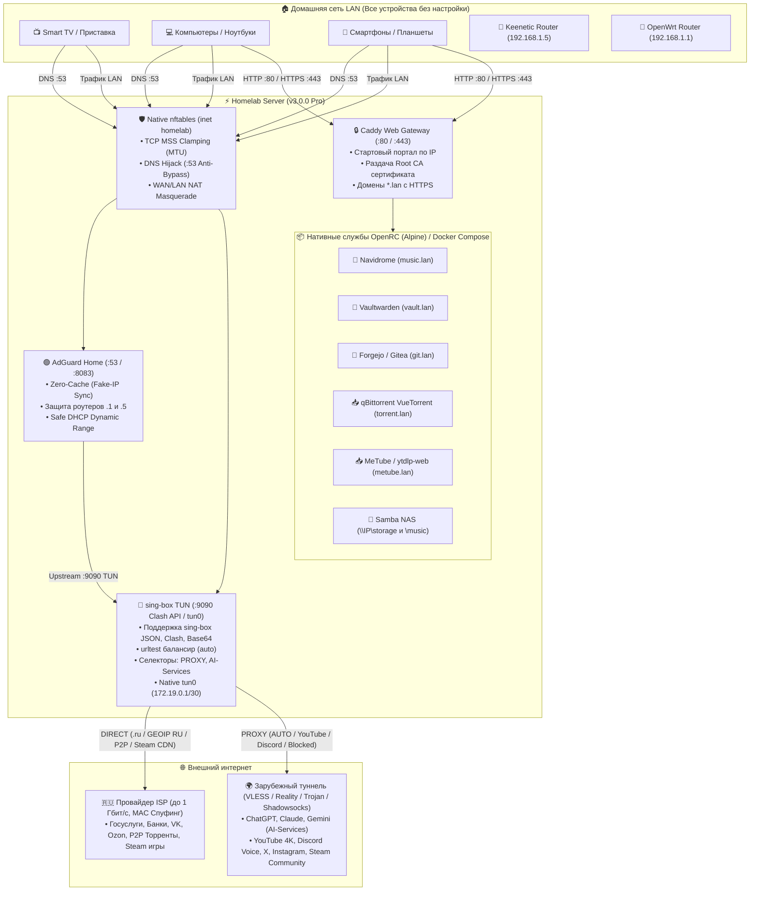

# 🛡️ Homelab Appliance & Transparent Gateway
### 🇷🇺 Russia Pro Edition 2026 • Умный прозрачный шлюз, роутер с клонированием MAC и автономная станция

<p align="center">
  
  
  
  
  
  
  
  
</p>

```text
  ███╗   ███╗███████╗██████╗  █████╗ ██╗     
  ████╗ ████║██╔════╝██╔══██╗██╔══██╗██║     
  ██╔████╔██║█████╗  ██║  ██║███████║██║     
  ██║╚██╔╝██║██╔══╝  ██║  ██║██╔══██║██║     
  ██║ ╚═╝ ██║███████╗██████╔╝██║  ██║███████╗
  ╚═╝     ╚═╝╚══════╝╚═════╝ ╚═╝  ╚═╝╚══════╝
  ╔══════════════════════════════════════════════════════════════════════════════╗
  ║   HOMELAB APPLIANCE & TRANSPARENT GATEWAY ◈ RUSSIA PRO 2026 (v3.0.0)          ║
  ╠══════════════════════════════════════════════════════════════════════════════╣
  ║  ◆ РЕЖИМ 1: ПРОЗРАЧНЫЙ ШЛЮЗ (1x NIC) ◈ РЕЖИМ 2: ДОМАШНИЙ РОУТЕР (WAN + LAN) ║
  ║  ◆ 100% NATIVE BARE-METAL НА ALPINE (ZERO DOCKER, OPENRC, ~500 МБ ОЗУ)       ║
  ║                                                                              ║
  ║   [ КЛИЕНТЫ LAN ] ──► [ ADGUARD :53 ] ──► [ SING-BOX TUN :9090 ]            ║
  ║   (ТВ, ПК, Смартфоны)  ZeroCache/DHCP      Clash API / Fake-IP / tun0        ║
  ║           │                     │                                            ║
  ║           │                     ▼ (Анти-Утечки)   Маршрутизация трафика:     ║
  ║           │              [ ECH / DOH DROP ]  ├─► [ AI-Services ] ChatGPT     ║
  ║           │                                  ├─► [ PROXY ] YT, Discord, X    ║
  ║           │                                  ├─► [ AUTO ] Urltest Балансир   ║
  ║           │                                  └─► [ DIRECT ] РФ / Банки / P2P ║
  ║           ▼                                                      │           ║
  ║   [ ISP WAN (Спуфинг MAC-адреса) / ПРЯМОЙ ВЫХОД ] ───────────────┘           ║
  ║   • Защита роутеров: OpenWrt 192.168.1.1 и Keenetic 192.168.1.5 защищены     ║
  ╚══════════════════════════════════════════════════════════════════════════════╝
```

---

## 🌟 Что это такое?

**Homelab Appliance & Transparent Gateway (v3.0.0)** — это автономная инженерная система «всё-в-одном» для домашнего сервера, мини-ПК (Intel N100, N5105, Raspberry Pi 4/5, Orange Pi, старый ПК, локальная ВМ или контейнер Proxmox).

Комплекс разворачивается в двух вариантах:
1. **100% Native Bare-Metal на Alpine Linux (Zero Docker):** Все 10 сервисов работают нативно под управлением супервизора OpenRC (`supervise-daemon`), потребляя суммарно всего **~400–600 МБ ОЗУ**!
2. **Контейнерный стек на Debian / Ubuntu:** Автономный самовосстанавливающийся Docker Compose стек.

### Главные возможности v3.0.0:
1. **Свободный интернет без настройки клиентских устройств:** На смартфонах, ТВ и компьютерах **не нужно** ставить VPN-приложения, включать расширения или сажать батарею. Вся сеть маршрутизируется прозрачно.
2. **Ядро sing-box TUN последнего поколения:** Нативный сетевой стек с интерфейсом `tun0`, совместимым с Clash API на порту `:9090` (веб-панель MetaCubeXD на `https://proxy.lan`), urltest-балансировкой и авто-обработчиком подписок (`sing-box JSON`, `Clash YAML`, `Base64`).
3. **Два сетевых режима:**
   * **Режим 1 (Прозрачный шлюз):** Работает в существующей сети с 1 сетевой картой (достаточно указать IP сервера как Gateway/DNS в роутере).
   * **Режим 2 (Домашний роутер):** Сервер берет кабель провайдера напрямую в WAN, раздает интернет в LAN, выполняет NAT-маскарадинг и спуфит MAC-адрес.
4. **Клонирование/Спуфинг MAC-адреса провайдера (ISP MAC Spoofing):**
   * В РФ провайдеры (Ростелеком, Дом.ру, МТС, Билайн, ТТК и др.) привязывают тариф к MAC-адресу роутера.
   * Комплекс позволяет ввести ваш оригинальный MAC-адрес при установке или изменить его на лету командой `homelab mac <НОВЫЙ_MAC>`. Настройка сохраняется персистентно в `/etc/network/interfaces`.
5. **Безопасный DHCP AdGuard Home:**
   * В Режиме 1 DHCP отключен по умолчанию, исключая конфликты с домашним роутером.
   * В Режиме 2 DHCP включается с безопасным динамическим диапазоном, который гарантированно исключает IP самого сервера и шлюза.
   * Адреса **`192.168.1.1`** (OpenWrt) и **`192.168.1.5`** (Keenetic) жестко зарезервированы статической защитой, исключая сетевые коллизии.
6. **Личные облачные сервисы без абонентской платы:** Hi-Fi стриминг (Navidrome), загрузчик медиа (MeTube / ytdlp-web), менеджер паролей (Vaultwarden), Git-сервер (Forgejo / Gitea), торрент-качалка (qBittorrent VueTorrent) и Samba NAS.

---

## 🎯 Сравнение сетевых режимов

| Параметр | Режим 1: Прозрачный шлюз (Gateway) | Режим 2: Домашний роутер (Router Mode) |
| :--- | :--- | :--- |
| **Сетевые интерфейсы** | 1 физический интерфейс (`eth0` / `enp3s0`) | 2+ интерфейса: **WAN** (к провайдеру) + **LAN** (к коммутатору/AP) |
| **Роль основного роутера** | Сохраняется ваш Keenetic / OpenWrt / MikroTik | Сам сервер становится главным роутером квартиры |
| **DHCP-сервер** | Раздает ваш роутер (в AdGuard выключен для защиты) | Раздает AdGuard Home (с защитой адресов `.1` и `.5`) |
| **Привязка провайдера** | Не требуется (роутер уже авторизован) | **Клонирование MAC-адреса** (`homelab mac`) |
| **Маршрутизация** | Клиенты шлют трафик на IP сервера через роутер | Прямой NAT-маскарадинг LAN &rarr; WAN + sing-box TUN |

---

## ⚡ Архитектура и вызовы РФ в 2026 году

Большинство стандартных VPN-решений в России либо ломают Госуслуги и банковские приложения, либо вызывают бесконечную буферизацию YouTube из-за замедлений ТСПУ. Наш комплекс решает каждую из этих проблем на уровне сетевого ядра:

| Вызов в РФ (РКН / ТСПУ) | Инженерное решение в комплексе |
| :--- | :--- |
| **YouTube 4K & Google CDN** | **sing-box TUN & Anti-Throttling:** Трафик YouTube и `*.googlevideo.com` направляется в оптимизированный туннель. Активирован автоматический сброс замедленного QUIC (UDP 443 дропается для заблокированных ресурсов), что принуждает браузеры переходить на быстрый TCP/TLS без потери пакетов. |
| **Голосовая связь Discord & Игры** | **Full-Cone NAT & Endpoint-Independent Mapping:** Полная поддержка UDP-трафика и голосовых серверов Discord Voice без односторонней слышимости и зависаний на «Connecting RTC». |
| **Геоблокировки AI (ChatGPT, Claude, Gemini)** | **Динамическая группа `AI-Services`:** Трафик нейросетей автоматически фильтруется и направляется на выделенные ноды, предотвращая «Access Denied». |
| **Госуслуги, Банки, Кинопоиск, VK, Доставка** | **100% Прямой выход (DIRECT):** Все зоны `.ru`, `.su`, `.рф`, реестры `category-ru` и гео-базы российских подсетей выведены в нативный bypass на полной скорости провайдера (до 1 Гбит/с, без капч и ограничений). |
| **Привязка ISP к MAC-адресу** | **Встроенный MAC-Cloner:** Поддержка любого MAC-адреса вашего старого роутера (`hwaddress ether` в `/etc/network/interfaces`) с мгновенной сменяемостью через CLI: `homelab mac 00:11:22:33:44:55`. |
| **Защита существующей сети OpenWrt / Keenetic** | Защитный шлюз AdGuard Home: жестко резервирует `192.168.1.1` и `192.168.1.5`, никогда не занимая их в DHCP. |
| **Личный Spotify для авто и метро** | **Триада Navidrome + MeTube + Samba:** Сервер стриминга Hi-Fi аудио (~40 МБ ОЗУ). Скачиваете треки через MeTube ➔ они индексируются в `/music` ➔ нативные приложения **Symfonium** (Android), **Substreamer** (iOS) и **Feishin** (ПК) дают 100% офлайн-кэш, тексты песен в такт, CarPlay и Android Auto. |
| **P2P-торренты без сжигания трафика прокси** | Трафик пиров BitTorrent (порты 6881–6889, 51413) изолирован и идет **напрямую**, не нагружая зарубежный VPS. При этом заблокированные трекеры (RuTracker, Rutor, Flibusta, NNMClub) прозрачно проксируются. |
| **Утечки DNS на Smart TV и приставках** | **Native DNS Hijacking в nftables:** Любые скрытые DNS-запросы на порт 53 (даже если телевизор захардкодил `8.8.8.8` или `1.1.1.1`) на лету перехватываются и направляются в AdGuard Home. |
| **Блокировки ECH со стороны ТСПУ** | В AdGuard Home активированы `block_ech: true` и фильтр `|*^$dnstype=HTTPS`. Это предотвращает невидимый сброс TLS-соединений на ресурсах Cloudflare. |
| **Скрытый обход шлюза через Apple iCloud** | Встроена канареечная блокировка `mask.icloud.com` и `mask-h2.icloud.com`. Техника Apple видит домашний шлюз и корректно использует его, не уходя во встроенный обход. |
| **Зависания страниц на PPPoE/L2TP** | **TCP MSS Clamping (`rt mtu`) в nftables:** Пакеты автоматически подгоняются под MTU провайдера, предотвращая фрагментацию и «залипание» сайтов. |

---

## 🏗️ Интерактивная схема движения трафика



---

## 🌐 Каталог встроенных веб-сервисов

Сервер полностью готов к работе сразу после завершения установки:

| Служба | Локальный домен | Назначение | Доступ / Авторизация |
| :--- | :--- | :--- | :--- |
| **Портал навигации** | `http://<IP-сервера>/` | Главный дашборд со ссылками на все службы и кнопкой скачивания Root CA | Открытый (LAN) |
| **Navidrome Music** | `https://music.lan` | Музыкальный Hi-Fi стриминг (OpenSubsonic API, тексты песен, обложки) | Создание админа при первом входе |
| **MeTube / yt-dlp** | `https://metube.lan` | Загрузка видео и аудио с YouTube, VK, RuTube, TikTok (yt-dlp) | Открытый (LAN) |
| **AdGuard Home** | `https://adguard.lan` | Панель DNS-сервера, статистика блокировок, белые/черные списки, DHCP | `admin` / Мастер-пароль |
| **sing-box Web UI** | `https://proxy.lan` | Панель MetaCubeXD: Clash API `:9090`, пинг нод, выбор прокси, трафик | Секрет (Мастер-пароль) |
| **Vaultwarden** | `https://vault.lan` | Персональный менеджер паролей (совместим с приложениями Bitwarden) | Личная регистрация + `/admin` токен |
| **Forgejo / Gitea** | `https://git.lan` | Персональный Git-сервер (SSH порт `2222`, веб-интерфейс, Webhooks) | `admin` / Мастер-пароль |
| **qBittorrent** | `https://torrent.lan` | Торрент-клиент с интерфейсом **VueTorrent** и прямым P2P-выходом | `admin` / Мастер-пароль |
| **Samba (Хранилище)** | `\\<IP>\storage` | Сетевая папка Windows / Mac / Android TV (авто-дискавери WSDD2) | `admin` / Мастер-пароль |
| **Samba (Медиатека)** | `\\<IP>\music` | Прямой доступ к медиатеке Navidrome для закидывания треков с ПК | `admin` / Мастер-пароль |

*(При выборе SSL-режима DuckDNS вместо `.lan` используются адреса вида `*.ваш-домен.duckdns.org`)*

---

## 🚀 Быстрый старт: Установка в 1 команду

### Системные требования:
* **Поддерживаемые ОС:** Alpine Linux v3.19+ (рекомендуется для минимального потребления памяти), Debian 12/13, Ubuntu 24.04/26.04 LTS, Arch Linux.
* **Архитектура процессора:** `x86_64` (Intel/AMD) или `aarch64` (ARM64, Raspberry Pi 4/5, Orange Pi).
* **ОЗУ:** от **512 МБ** на Alpine Linux Bare-Metal! (На Debian/Ubuntu рекомендуется от 1–2 ГБ).
* **Права:** `root` (или запуск через `sudo`).

### Запуск установщика:

```bash
curl -fsSL https://raw.githubusercontent.com/unknownpeace/Medal/main/install.sh | sudo bash
```

> [!TIP]
> **Для чистой Alpine Linux:** Если в базовом образе отсутствует `curl` и `bash`, установите их одной командой:
> ```bash
> apk add --no-cache curl bash
> curl -fsSL https://raw.githubusercontent.com/unknownpeace/Medal/main/install.sh | bash
> ```

---

## ⚙️ Управление MAC-адресом провайдера (`homelab mac`)

Если ваш провайдер использует привязку по MAC-адресу (MAC binding):

```bash
# 1. Посмотреть текущий аппаратный и настроенный MAC:
homelab mac

# 2. Установить MAC-адрес вашего старого роутера:
homelab mac 00:11:22:33:44:55
```

Команда:
* Мгновенно применяет новый MAC-адрес к физическому WAN-интерфейсу на лету.
* Прописывает директиву `hwaddress ether <MAC>` в `/etc/network/interfaces` для сохранения после любых перезагрузок.
* Корректно перезапускает сетевой стек.

---

## 🔄 Подписки sing-box: Любые форматы из коробки

Встроенный конвертер подписок `update_singbox_sub.py`:
1. Поддерживает ссылки провайдеров любого вида:
   * **sing-box JSON** (нативные конфигурации с сотнями узлов).
   * **Clash YAML** (автоматически извлекает узлы `proxies:`).
   * **Base64 / Списки ссылок** (`vless://`, `trojan://`, `ss://`, `vmess://`).
2. Автоматически внедряет:
   * Балансировщик задержек `auto` типа `urltest` (выбирает самый быстрый узел каждые 5 минут).
   * Селектор `PROXY` для ручного выбора страны/ноды.
   * Выделенную группу `AI-Services` для стабильной работы нейросетей.
3. Проверяет корректность сгенерированного конфига через `sing-box check` перед перезапуском сервиса.
4. Обновляется автоматически раз в сутки через системный cron. Ручное обновление:
   ```bash
   /opt/homelab/scripts/update_singbox_sub.py
   ```

---

## 📱 Настройка роутера (для Режима 1: Шлюз)

Если комплекс работает в **Режиме 1 (Прозрачный шлюз)**:

1. Откройте веб-панель управления вашего домашнего роутера (**Keenetic**, **MikroTik**, **ASUS**, **OpenWrt**, **TP-Link**).
2. Перейдите в раздел **DHCP / Домашняя сеть (LAN)**.
3. Укажите:
   * **Основной шлюз (Default Gateway):** `IP-адрес вашего Homelab-сервера`
   * **Первичный DNS-сервер (Primary DNS):** `IP-адрес вашего Homelab-сервера`
4. Нажмите «Применить» и переподключите Wi-Fi на устройствах.

> [!NOTE]
> При работе в **Режиме 2 (Домашний роутер)** сервер подключается в разрыв: кабель провайдера в порт WAN, кабель к домашним устройствам/свитчу — в порт LAN. Настройки роутера на других устройствах менять не требуется!

---

## 🔒 Доверие локальным SSL-сертификатам

При работе с локальными доменами `.lan` сервер автоматически выпускает персональный корневой сертификат (Root CA). Чтобы браузеры показывали «зеленый замочек» без предупреждений:

1. Откройте в браузере стартовую страницу: `http://<IP-сервера>/`
2. Нажмите кнопку **«📥 Скачать Root CA Сертификат (caddy-root.crt)»**.
3. Добавьте его в доверенные корневые центры:
   * **Windows:** Дважды кликните по файлу `.crt` &rarr; «Установить сертификат» &rarr; «Текущий пользователь» &rarr; «Поместить в хранилище» &rarr; **«Доверенные корневые центры сертификации»**.
   * **iOS / iPadOS:** Скачайте профиль &rarr; «Настройки» &rarr; «Профиль загружен» &rarr; «Установить» &rarr; «Основные» &rarr; «Об этом устройстве» &rarr; «Доверие сертификатам» &rarr; включите тумблер для Caddy Root CA.
   * **Android:** «Настройки» &rarr; «Безопасность» &rarr; «Установка сертификатов» &rarr; «Сертификат CA».

---

## 🎵 Личный Spotify: Hi-Fi Музыкальный стриминг

Аудиосервер **Navidrome** потребляет всего **~40 МБ ОЗУ** и совместим с открытым протоколом **OpenSubsonic API**.

### 🔄 Бесшовный конвейер музыки:
1. **Скачивание через MeTube (`https://metube.lan`):** Вставьте ссылку на трек, плейлист или альбом из YouTube Music, VK, RuTube или SoundCloud — аудио скачается в максимальном качестве прямо в `/music`.
2. **Lossless FLAC с торрентов:** Качайте альбомы через qBittorrent прямо в папку `\\<IP>\music`.
3. **Копирование по сети:** Перетаскивайте аудиофайлы со своего ПК через проводник Windows или macOS Finder по Samba.

### 📱 Подключение приложений:
| Платформа | Рекомендуемое приложение | Возможности |
| :--- | :--- | :--- |
| **Android** | 👑 **Symfonium** *(или Tempo / Substreamer)* | **100% Офлайн-кэш** в память смартфона (для метро и самолёта), **Android Auto**, караоке-тексты песен в такт музыке, 10-полосный эквалайзер, Material You дизайн. |
| **iOS (iPhone/iPad)** | 👑 **Substreamer** *(или play:Sub / Amperfy)* | Интерфейс **точь-в-точь как Spotify**, тёмная тема, поддержка **Apple CarPlay**, офлайн-загрузка, кэширование. |
| **ПК (Win/Mac/Linux)** | 👑 **Feishin** *([GitHub](https://github.com/feishin/feishin))* | Премиальный десктопный плеер на базе движка MPV. Поддержка медиа-клавиш и Discord Rich Presence («Слушает в Navidrome»). |

> **Параметры входа в приложении:**  
> • Сервер: `https://music.lan`  
> • Логин: `admin`  
> • Пароль: ваш мастер-пароль

---

## 🛠️ Единая утилита управления `homelab`

После установки на сервере доступна глобальная консольная утилита:

```bash
homelab [КОМАНДА] [ПАРАМЕТРЫ]
```

### Справочник команд:
| Команда | Описание |
| :--- | :--- |
| `homelab status` | Интерактивный дашборд состояния сервера, памяти, накопителей, nftables и сервисов |
| `homelab doctor` | Комплексная самодиагностика DNS (:53), sing-box TUN, Clash API (:9090), MSS и сети |
| `homelab mac [MAC]` | Просмотр или установка MAC-адреса для провайдера (с персистентным сохранением) |
| `homelab install-log [-f]` | Просмотр журнала развертывания и таймингов профайлера (с ключом `-f` в реалтайме) |
| `homelab dump-logs [файл]` | Сборка логов всех сервисов, сетевого стека и установщика в единый архив |
| `homelab upgrade [--force]`| Бесшовное обновление ядра комплекса из GitHub (OTA In-Place Update) |
| `homelab rollback` | Мгновенный откат к предыдущей версии ядра из снимка восстановления |
| `homelab version` | Проверка установленной версии ядра и наличия новых релизов на GitHub |
| `homelab restart [сервис]` | Перезапуск всего комплекса или отдельной службы (`sing-box`, `caddy`, `vaultwarden`...) |
| `homelab logs [сервис] -f` | Просмотр живых логов службы в терминале в реальном времени |
| `homelab backup` | Мгновенный горячий бэкап баз данных SQLite (Vaultwarden, Forgejo, Navidrome) |
| `homelab cookies [файл]` | Управление cookies YouTube для загрузчика видео |
| `homelab notify [текст]` | Отправка тестового оповещения в Telegram |
| `homelab unlock` | Ручная разблокировка шифрованного диска LUKS2 |

---

## 🧩 Модульная архитектура исходного кода

Проект спроектирован по принципу модульного компилятора: исходные компоненты разделены по функциональным файлам в `src/`, а сборщик `build.sh` компилирует их в готовый монолитный `install.sh`:

```text
.
├── VERSION                   # 🏷️ Версия релиза комплекса (3.0.0)
├── build.sh                  # 🔨 Компилятор/бандлер (собирает src/*.sh в install.sh)
├── install.sh                # 🚀 Готовый автономный установщик (для развертывания в 1 команду)
├── README.md                 # 📖 Документация проекта
└── src/                      # 📂 Исходные модули комплекса:
    ├── 00_header.sh          # Палитра цветов, логгер install.log, спиннер run_spin, crash-dump
    ├── 01_system.sh          # Баннер, детекция CPU/RAM/OS, синхронизация времени
    ├── 02_packages.sh        # Пакетный менеджер: нативные APK на Alpine, Docker CE на Debian/Ubuntu
    ├── 03_network.sh         # Анализ сети: обнаружение всех физических интерфейсов
    ├── 04_config.sh          # Мастер настроек: выбор Режима 1/2, WAN/LAN, ISP MAC, подсети
    ├── 05_gateway.sh         # Твики ядра, MAC-спуфинг, nftables (dual-mode NAT), watchdog
    ├── 06_directories.sh     # Создание каталогов, No-COW (+C), предзагрузка UI и правил
    ├── 07_dns_bench.sh       # Параллельный DoH/DoT бенчмарк апстримов с гео-приоритетом
    ├── 08_services_conf.sh   # Конфиги AdGuard Home (Safe DHCP) и sing-box sub updater
    ├── 09_compose_caddy.sh   # Caddyfile (SSL/CA), OpenRC сервисы (Alpine) и compose.yaml (Debian)
    ├── 10_backups_cli.sh     # Служба авто-бэкапов, homelab CLI (doctor, mac, status)
    └── 11_diagnostics.sh     # Самодиагностика, вывод топологии сети и итоговый дашборд
```

### Как разрабатывать и вносить изменения:
1. Отредактируйте нужный модуль внутри каталога `src/`.
2. Запустите компилятор сборки:
   ```bash
   ./build.sh
   ```
3. Зафиксируйте изменения в Git:
   ```bash
   git add -A
   git commit -m "feat: описание ваших доработок"
   git push origin main
   ```
После этого при выполнении команды `homelab upgrade` или однострочника установки на любом сервере автоматически применится ваша свежая сборка!

---

## 💾 Оптимизация дискового пространства и баз данных

* **Btrfs No-COW (`chattr +C`):** На файловых системах Btrfs скрипт автоматически отключает Copy-on-Write на каталогах баз данных SQLite (Vaultwarden, Forgejo, AdGuard Home) и папке загрузок qBittorrent. Это исключает фрагментацию и бережет ресурс SSD.
* **Шифрование LUKS2 с Argon2id:** В кастомном режиме поддерживается создание защищенного блочного раздела (`cryptsetup luksFormat --type luks2 --pbkdf argon2id`) с утилитой ручной и автоматической разблокировки.
* **Горячие резервные копии:** Каждую ночь создаются онлайн-снимки баз данных через потоковый SQLite Backup API со складированием архивов в защищённую директорию хранилища с ротацией 14 дней.

---

## 📄 Лицензия

Проект распространяется под свободной лицензией **MIT**. Подробности в файле [LICENSE](LICENSE).
